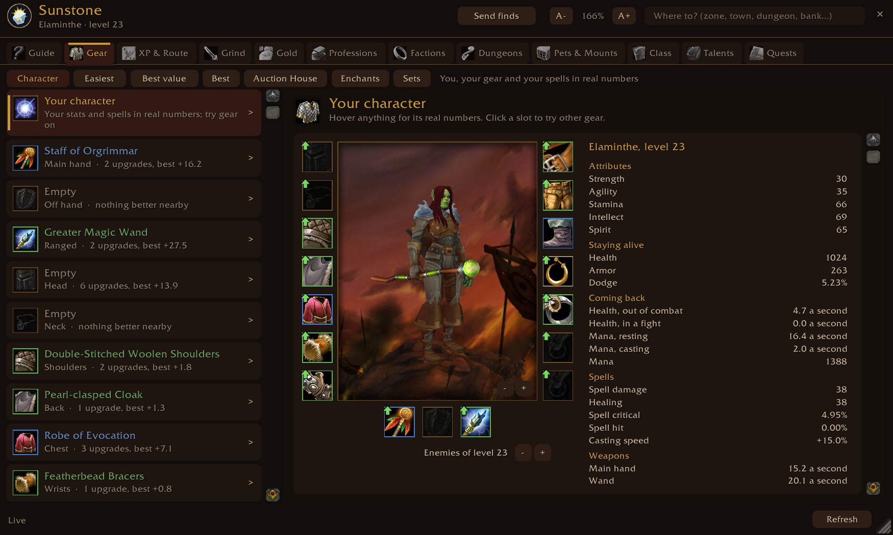
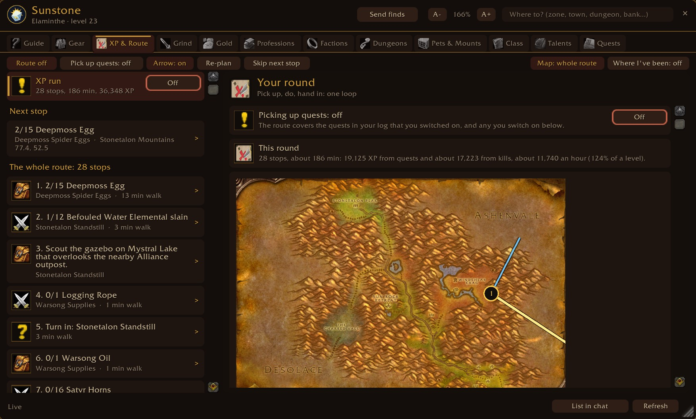
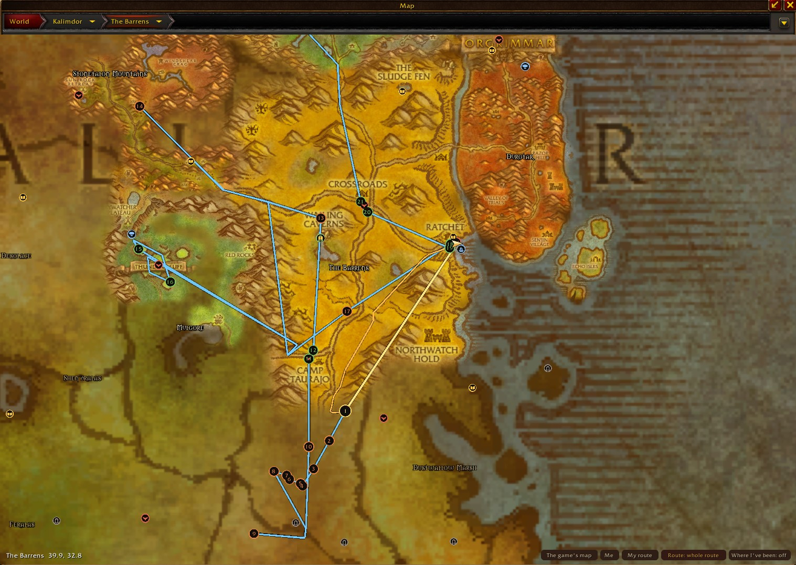
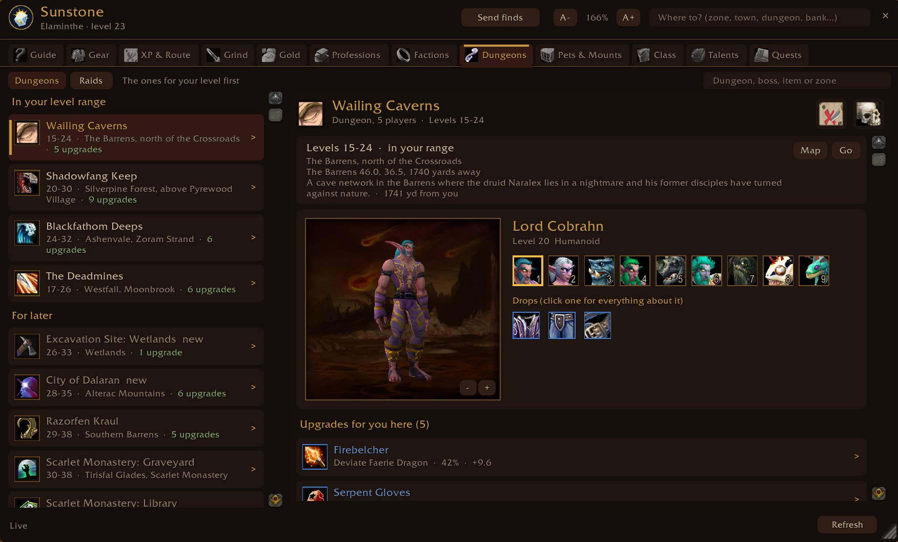
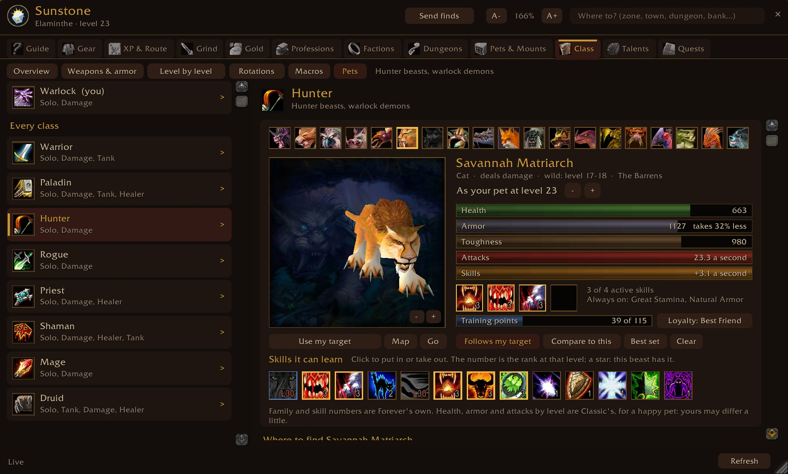

# Sunstone

**Beta, first release.** A leveling companion for **World of Warcraft: Forever**. One window that knows your character: quest route and search, gear upgrades and spells in real numbers, a hunter pet planner, talents, professions, dungeons, gold, travel and more. Information only: it never plays for you.

Named after the Viking sunstone, the crystal that finds the sun through fog.

| | |
|---|---|
|  |  |
|  |  |

More in [docs/pictures](docs/pictures).

## Install

Get it from CurseForge, or download `Sunstone-<version>.zip` from the **Releases** page here and unzip it into

    World of Warcraft\_forever_\Interface\AddOns\

so that there is a folder `AddOns\Sunstone` with `Sunstone.toc` in it. Restart the game. Open the window with the minimap button or `/sun`.

(The green "Code > Download ZIP" button also works, but then the folder has to be renamed to `Sunstone`.)

## What's in it

| | |
|---|---|
| Quests and route | XP runs (pick up, do and hand in, in one round), arrow, trail around the terrain, order by path, XP or rewards, search with chain maps, quest icons on the map |
| World map | one smooth map you zoom and drag, from the world to a camp, with your explored land, the route across zones, where you've been |
| Character | 3D, every stat explained in numbers, spells against an enemy level, trying gear on |
| Gear | upgrades for your class and goal, enchants, sets |
| Pets | hunter pet planner, demons, companion pets and mounts in 3D |
| Talents | plans for every class on your own trees |
| Professions | cheapest path to skill up, crafting list, profit, recipe search |
| Dungeons | bosses, loot, inside maps |
| Gold, grind, factions, travel, class guides | and tooltips, auction prices, vendor flips |

`/sun help` lists every command.

## Rules it keeps

* Information only: it never casts, moves, buys, sells, accepts or hands in anything.
* It registers no chat, whisper, mail or addon message events and sends nothing by itself. Sharing finds is off unless you say Yes when it asks (once), or press Share finds at the top of its window; the addon then writes them into your own saved settings, and you send them by hand or with a separate program you choose to run.
* What it records (drops, prices, quest rewards) stays in your own SavedVariables.

## Known limits

* English client.
* Some numbers are Classic's where nobody knows Forever's yet. The pages say so.
* Set bonuses, enchants on gear you try on, and effects that go off by chance aren't counted on the character page.
* The inside maps of Forever's five newest dungeons are missing.

## Free, and it stays free

If it saved you a subscription and you're feeling generous, [a small donation](https://ko-fi.com/malefactor2000) is welcome and helps keep it going. It's never expected and unlocks nothing: everyone gets all of it.

## Reporting a problem

Open an issue with a screenshot and what `/sun errors` prints. Please don't include anything private.

## Licence and credits

GPL-3.0 (see `LICENSE`). Data sources and their licences: `LICENSES-DATA.txt` and `THIRD-PARTY-NOTICES.txt`. With thanks to Smoergi (OneForAll), the Questie team, CMaNGOS, Frostmil, Supersharpie, Pimptasty, Tarolg, Nevcairiel and Petopia.

World of Warcraft is a trademark of Blizzard Entertainment. Sunstone isn't connected with or endorsed by Blizzard.
